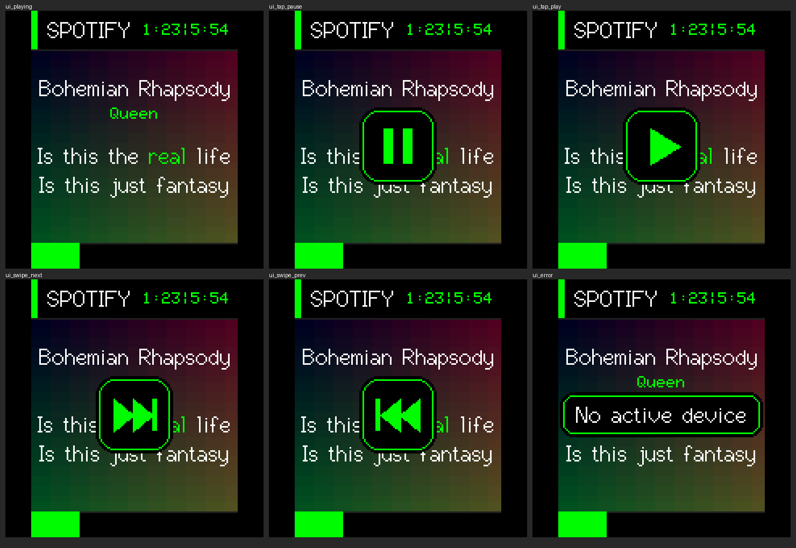

# ESPotify 
(Requires spotify premium!!!)
ESPotify is a esp32 firmware that connects to your Spotify account and beautifully renders your currently playing track, artist name, album art, and live synced lyrics directly onto a small TFT LCD screen! It features a built-in Captive Portal for extremely easy Wi-Fi and Spotify credential setup.

##  Features
- **Live Album Art & Metadata**: Instantly updates when a new song plays on your Spotify account.
- **Synced Lyrics**: Displays live lyrics synchronized to the song (disappears when the music is paused).
- **Captive Portal Setup**: No hardcoding needed! Connect to the `ESPotify-Setup` Wi-Fi network to enter your credentials securely from your phone.
- **Web Control Panel**: Change screen brightness, set a screen timeout, and restart the device from your browser.
- **Over-The-Air (OTA) Updates**: Easily update your ESPotify firmware to the latest version directly from the Web Control Panel without plugging it into a PC.

##  Components Used
To build this project, you only need two main components:
1. **ESP32 Dev Module** (Standard 240MHz, 4MB Flash)
2. **1.8" TFT LCD Display (SPI)** (Uses the ST7735 driver chip)

> [!WARNING]
> **Disclaimer:** This firmware supports the **1.8 inch TFT LCD Display (ST7735)** and the **Waveshare ESP32-C6 2.16" AMOLED Touch board** (see below). Using it with other displays (like ILI9341 or SSD1306) will result in broken graphics or a white screen.

##  Waveshare ESP32-C6 2.16" AMOLED Touch Board
The [Waveshare ESP32-C6-Touch-AMOLED-2.16](https://www.waveshare.com/esp32-c6-touch-amoled-2.16.htm) works out of the box: the display, touch panel and buttons are built in, so there is no wiring.

It has its own **ladybug theme**: a pastel polka-dot screen with the album cover on a little card (shown sharp, at the panel's full resolution), and a ladybug that walks along a flowering vine as the song plays. Flowers bloom wherever she has been, and she naps when the music is paused. If a song has no cover art, a big ladybug says hi instead.

**Touch controls**
| Gesture | Action |
| :--- | :--- |
| Tap | Play / Pause |
| Swipe left | Next track |
| Swipe right | Previous track (Spotify restarts the current song if it is more than a few seconds in) |
| Tap while the screen is off | Wake the screen |

An icon confirms each gesture. If Spotify refuses the command, a short message appears instead, for example *No active device* when nothing is playing on any of your devices.

**Buttons:** press **BOOT** to wake the screen, hold it for 3 seconds to factory reset.

**Flashing:** build and upload the `waveshare_c6_amoled_216` environment with PlatformIO (`pio run -e waveshare_c6_amoled_216 -t upload`). This board uses its own firmware, so the *Check for Updates* button is hidden in its Web Control Panel and the release `.bin` files below are for the ST7735 build only.

The theme is drawn at 160x160 and scaled 3x to fill the 480x480 panel (see `include/ui_ladybug.h`). Orientation follows Waveshare's own demo. If your picture comes out upside down, try setting `AMOLED_MADCTL` in `include/config.h` to `0xF0`. If swipes go the wrong way, flip `TOUCH_INVERT_X`.

##  Wiring Guide (recommended)

Connect the 1.8" TFT display to your ESP32 using the following pins:

| Display Pin | ESP32 Pin | Function |
| :--- | :--- | :--- |
| **VCC** | 3.3V | Power |
| **GND** | GND | Ground |
| **CS** | GPIO 5 | Chip Select |
| **RST** | GPIO 4 | Reset |
| **DC / A0** | GPIO 2 | Data / Command |
| **SDA (MOSI)**| GPIO 23 | SPI Data |
| **SCK (SCL)** | GPIO 18 | SPI Clock |
| **LED / BL** | GPIO 22 | Backlight Control |

##  Installation & Usage

### 1. Flash the Firmware
- Download the latest **`espotifyvX.X.X-pre_merged.bin`** file from the [Releases](https://github.com/meritman/espotify/releases) page.
- Connect your ESP32 to your PC via USB.
- Go to an ESP Web Flasher https://espflash.app/
- or ( [espboards.dev/tools/program](https://www.espboards.dev/tools/program/)) and flash the merged `.bin` file at offset `0x0`.

### 2. Connect to Wi-Fi
- Once flashed, the ESP32 will reboot and create a Wi-Fi network called **`ESPotify-Setup`**.
- Connect to this network on your phone or PC. A Captive Portal window should pop up automatically. (If it doesn't, open a browser and go to `http://192.168.4.1`).
- Select your home Wi-Fi network and enter the password to connect the ESP32 to your internet.

### 3. Setup Spotify API
To let ESPotify read your playback, you need a free Spotify Developer app:
1. Go to the [Spotify Developer Dashboard](https://developer.spotify.com/dashboard) and log in.
2. Click **Create App** (Name it whatever you want).
3. Set the **Redirect URI** to: `http://127.0.0.1:8080/callback`
4. Check the **Web API** box and save.
5. Go to your App Settings and copy the **Client ID** and **Client Secret**.
6. Enter these into the ESPotify Setup Portal when prompted!

### 4. Control Panel & Updates
After setup is complete, your ESPotify will display an IP address (e.g., `192.168.1.50`). 
Type this IP address into your web browser at any time to access the **Web Control Panel**. From here, you can adjust screen brightness, set a screen timeout, and click **Check for Updates** to seamlessly install future firmware releases over the air!

---
*Created by [meritman](https://github.com/meritman)*
