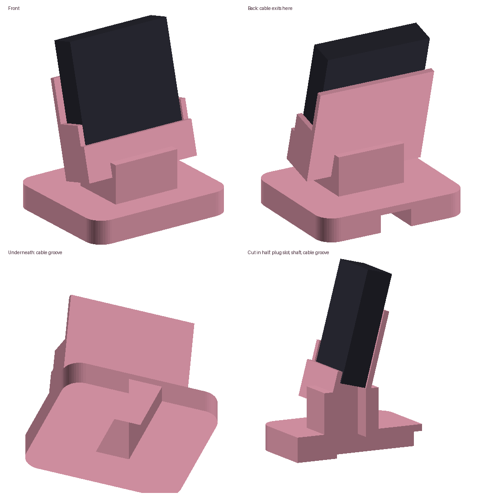

# ESPotify desk stand

A tilted cradle for the Waveshare ESP32-C6-Touch-AMOLED-2.16, with the USB-C
cable passing through the stand: the plug goes down through a slot in the
cradle floor, the cable drops through the pedestal and leaves through a groove
under the base, so the stand sits flat with the cable coming out the back.



## Print

`espotify-stand.stl`: print it base-down, no supports, 0.2 mm layers, 3 walls,
about 15-20% infill. It's about 70 x 60 x 62 mm.

## Fit it to your board

The board size in the STL is an estimate (50 x 50 x 12 mm). Measure your board
and change the numbers at the top of `make_stand.py`:

| Setting | What to measure |
| :--- | :--- |
| `BOARD_W`, `BOARD_H` | Width and height of the front of the board |
| `BOARD_T` | Total thickness, including parts on the back |
| `USB_X` | How far the USB-C port is from the middle of the bottom edge |
| `LIP_H` | Lower this if the front lip covers the bottom of the screen |
| `TILT` | How far the screen leans back, in degrees |

Then regenerate the STL:

```
pip install manifold3d numpy
python make_stand.py
```

## Fitting the cable

Thread the cable from the back: push its far end (USB-A or USB-C) along the
groove under the base, up through the pedestal and out of the slot in the
cradle floor. Plug it into the board, then lower the board into the cradle,
pulling the slack back through. A plug up to about 12.5 x 7 mm fits; a slim
or right-angle USB-C plug makes it easier.
